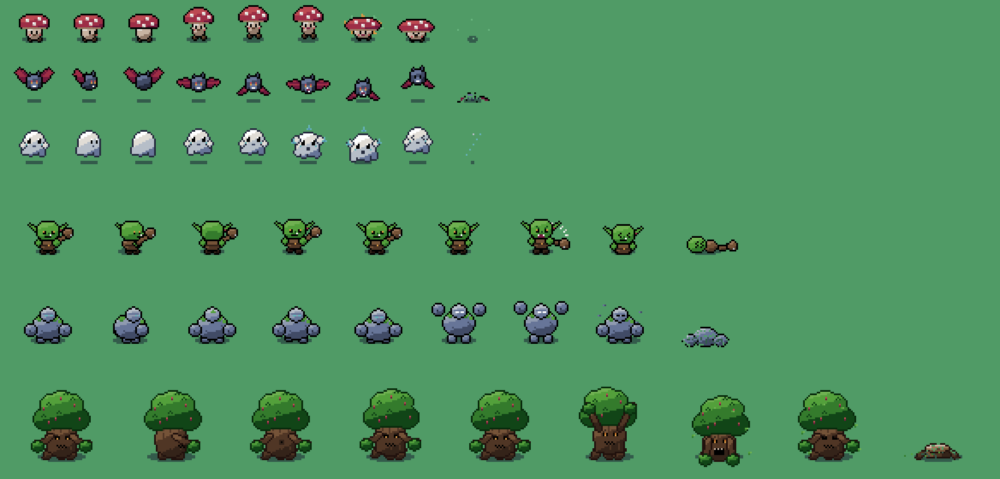
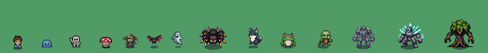

# Mystic Woods RPG — v0.2

RPG de ação de mundo aberto em pixel art, feito no **Godot 4.7.2** com o pack **Mystic Woods** e 6 monstros novos desenhados no mesmo estilo do pack.



## v0.2 — Monstros, minérios e itens da PixelLab


- **5 monstros novos gerados na PixelLab** e convertidos para o layout do pack (mesmas 13 linhas, pés na linha do chão, sombra do pack):
  - Orc Guerreiro (Floresta e Coração da Floresta) — golpe de clava
  - Lobo Sombrio (Floresta, mais à noite) — rápido, investida com mordida
  - Aranha da Caverna (Ruínas e Pedreira) — corre e dá o bote
  - Sapo do Pântano (Pântano e Prado) — anda pulando, ataca com a língua
  - Elemental de Cristal (Pedreira) — lento, soco de cristal em área
- **Minérios e plantas no mundo** (arte PixelLab): veios de cobre, carvão, ferro, prata, ouro, cristal, ametista e rubi; moitas de erva, frutinhas, hortelã, macieiras, cogumelos azuis e flores lunares. Minério se quebra com golpes; planta se colhe com E (ou golpe). Tudo volta a crescer depois de um tempo.
- **Picaretas**: cobre e carvão saem na mão; ferro e prata pedem Picareta de Cobre; ouro, cristal, ametista e rubi pedem Picareta de Ferro; a de Ouro minera com metade dos golpes.
- **29 itens colecionáveis** com ícones PixelLab: minérios, gemas, plantas e partes de monstros (gosma, esporos, asa, ectoplasma, osso, dente, núcleo de golem, pele de lobo, presa de orc, seda, perna de sapo, cerne do Ent). Cada monstro tem seus drops.
- **Vila com 3 NPCs** (PixelLab, feitos a partir do herói do pack para ter as mesmas proporções):
  - **Ferreiro**: picaretas, Espadas de Ferro/Prata/Cristal e Armaduras de Couro/Ferro.
  - **Alquimista**: poções, Tônico de Força (+ATK), Elixir de Vida (+vida máx.) e Poção Pele de Pedra (+DEF).
  - **Mercador**: compra qualquer material e vende poções.
- **Mochila** (I ou B, ou pelo menu de pausa) e aviso de coleta no canto da tela.
- Missões novas: minerar cobre, colher ervas, sapos, lobos, aranhas, forjar uma Picareta de Ferro, orcs e elementais (18 no total).

### Pipeline PixelLab (tools/)
1. Sprite de frente com `create_image_pixflux` usando a paleta do pack (`color_image`), em tela 32×32 para sair no tamanho certo.
2. `create_character` modo v3 com esse sprite como referência → 4 direções.
3. `animate_character` (templates para orc/lobo, v3 para o resto): idle, move, attack, damaged e death.
4. `python3 tools/pixellab_import.py <nome> <pasta_exportada> 48` encaixa tudo no layout do pack, ajusta a paleta, alinha os pés, põe a sombra e atualiza `scripts/MonsterFrames.gd`.
5. Ícones e veios: `create_1_direction_object` com recortes do pack como `style_images` (64 variações por chamada).

### Limpeza de pixels soltos (tools/pixel_cleanup.py)
A arte gerada por IA deixa um pontilhado fino de pixels soltos. `python3 tools/pixel_cleanup.py <sprite.png> [saida.png] --dist 20 --passes 3` reduz a folha inteira para até 28 cores (mesma paleta em todos os quadros) e absorve ilhas de 1–2 px na cor vizinha parecida, sem mexer no contorno, nos brilhos, nos detalhes coloridos (olhos, gemas, frutos) nem nas sombras semitransparentes. Aplicada em todos os monstros e NPCs (antes/depois em `docs/limpeza_pixels_*.png`). Use também em toda arte nova.

## Abrir o jogo
1. A licença do Mystic Woods não permite redistribuir os arquivos, então eles **não** ficam no repositório. Extraia o ZIP do pack e copie a pasta `sprites` para `assets/mystic_woods/`, ficando `assets/mystic_woods/sprites/characters/player.png` etc.
2. Abra o Godot 4.7.2, importe `project.godot`, espere a importação dos PNGs e aperte **F5**.

## Controles
| Ação | Teclado | Controle |
|---|---|---|
| Mover | WASD / setas | analógico / direcional |
| Atacar | J, Espaço, Z ou clique | A |
| Esquiva (invulnerável) | K, Shift ou X | B |
| Poção | Q ou H | X |
| Interagir (baú, placa, fonte) | E ou Enter | Y |
| Mapa | M ou Tab | Back |
| Pausa | Esc ou P | Start |
| Mochila | I ou B | RB |

### No celular (Android)
Os controles de toque aparecem sozinhos em aparelhos com tela de toque:

| Onde | Botão | O que faz |
|---|---|---|
| Metade esquerda | Joystick | Toque em qualquer ponto e arraste; empurrar pouco anda devagar, empurrar tudo corre |
| Direita, embaixo | Espada (grande) | Ataca; segurando, continua atacando |
| Ao lado da espada | Setas » | Esquiva (invulnerável); o anel amarelo mostra a recarga |
| Acima da esquiva | ! | Interagir: brilha quando há baú, placa, NPC ou planta por perto |
| Acima da espada | Poção | Bebe uma poção; o número mostra quantas restam |
| Topo | Bolsa / Mapa / Pausa | Mochila, mapa do mundo e menu de pausa |

Dá para mover e atacar ao mesmo tempo (multitoque). O celular vibra de leve na esquiva, ao acertar um golpe e ao levar dano (no export para Android, marque a permissão **VIBRATE**).

### Baixar a versão mais nova
Toda atualização vai para o GitHub. ZIP do projeto: https://github.com/Blucas157/Blucas157/archive/refs/heads/ccr-27b4daf4-fxt1tn.zip (o projeto do Godot é a pasta `mystic-woods-rpg`).

## Efeitos visuais (assets/vfx) e botões (assets/ui/touch.png)
Feitos no PixelLab: `vfx_workbench` para o corte da espada, a faísca de golpe, a fumaça de morte e o anel de cura da poção; `create_ui_asset` para os aros de madeira do joystick e dos botões. Os quadros de cada efeito estão em `Fx.SHEETS` e são criados com `main.vfx(tipo, posição, rotação, cor, pai, escala)`.

## Aplicativo Android (APK)
O preset "Android" (`export_presets.cfg`) gera um APK que se instala direto no celular (paisagem, tela cheia, vibração, ícone do goblin).
- A chave de assinatura fica só no repositório privado.
- **Gerar de novo (Linux, sem Android Studio):** `tools/android/build_apk.sh <godot> <keystore> <alias> <senha> [saida.apk]` instala os modelos de exportação do Godot 4.7.2 e um assinador mínimo (`tools/android/ApkSignerTool.java`) e exporta.
- **Pelo Godot no celular:** Projeto > Exportar > Android, com a mesma keystore em "Release".

## Sistema de Rivais
Monstros lembram de você:
- **Te derrotou?** O monstro que deu o golpe final vira um **rival**: ganha nome (ex.: *Grak*), título (*Matador do Herói*) e sobe de nível.
- **Fugiu ferido?** Às vezes um monstro com pouca vida foge gritando "Isso não acabou!". Se escapar, volta como rival *o Marcado*.
- **Ele volta:** depois de um tempo, o rival reaparece na região dele, maior, com o nome sobre a cabeça, um aviso na tela e uma provocação que lembra o que aconteceu.
- **Fica pior a cada encontro:** cada nova vitória dele sobe o título (*Matador → Flagelo → Pesadelo do Herói*); cada nova fuga deixa outra cicatriz (*o Marcado → o Cicatrizado → o Indomável*).
- **Derrote-o** para ganhar muito ouro, XP extra e uma gema (rubi ou esmeralda).
- No máximo 3 rivais ao mesmo tempo; nenhum nasce na vila. A lista fica em **Pausa → Rivais** e é salva com o jogo.

## O mundo
Mapa de 200×200 tiles (3.200×3.200 px) gerado a partir de uma semente salva com o jogo — cada jogo novo tem um mundo diferente. Tiles com borda automática (trilhas, rochas), lagos animados com lírios e ilhas, platôs, ruínas de pedra, cercas e centenas de árvores, arbustos, troncos, lápides etc.

| Região | Onde | Monstros |
|---|---|---|
| Vila do Bosque | centro (segura) | — fonte cura e salva, placa mostra a missão, baú inicial |
| Prado Verdejante | em volta da vila | Slime, Cogumelo, Morcego |
| Floresta Sombria | leste | Goblin, Goblin Chefe, Cogumelo, Morcego |
| Ruínas Antigas | norte | Esqueleto, Esqueleto Sombrio, Fantasma |
| Pedreira Rochosa | oeste | Golem de Pedra, Morcego, Slime de Fogo |
| Pântano dos Lírios | sul | Slime Venenoso, Cogumelo, Fantasma |
| Coração da Floresta | extremo leste | **Ent Ancião** (chefe) |

- O nível dos monstros sobe com a distância da vila (Nv 1 a 12).
- Ciclo de dia e noite (6 min); à noite aparecem mais monstros e fantasmas em todo lugar.
- Minimapa com névoa: só aparece o que você já explorou. O mapa grande (M) marca vila, regiões e baús vistos.
- 35 baús espalhados (ouro, poções, Espada melhorada +3 ATK, Cristal de Vida +5 HP), potes e caixotes quebráveis.

## Monstros novos (assets/monsters)
Todos seguem as regras do pack: grade de 32 px (como o slime) ou 48 px (como o esqueleto), contorno de 1 px, 2–4 tons de sombreamento com luz de cima, sombra elíptica translúcida `#171c31`, paleta extraída do próprio pack e o mesmo layout de linhas: `[0-2]` parado, `[3-5]` andando, `[6-8]` ataque, `[9-11]` dano (baixo, lado, cima) e `[12]` morte.

| Monstro | Grade | Comportamento |
|---|---|---|
| Cogumelo | 32 | anda pulando; ataque em área com nuvem de esporos |
| Morcego | 32 | voo errático, investida com mordida, voa sobre água |
| Fantasma | 32 | atravessa paredes, assusta ("boo") com chamas azuis |
| Goblin | 48 | rápido, golpe de clava com rastro |
| Golem de Pedra | 48 | lento e resistente, soco no chão com onda de choque |
| Ent Ancião | 64 | chefe: pancada em área, chama cogumelos e goblins a 75/50/25% da vida |

Variantes por shader (sem novos PNGs): Slime de Fogo, Slime Venenoso, Goblin Chefe (mudança de matiz) e Esqueleto Sombrio (tinta). Também foram desenhados a moeda girando e os ícones do HUD (`assets/ui`).

Para editar ou criar monstros: os sprites são gerados por código em `tools/` (Python + Pillow).

```
python3 tools/generate_monsters.py   # recria assets/monsters/*.png
python3 tools/generate_items.py      # moeda e ícones
```

## Progressão
- XP sobe de nível (+6 vida, +2 ataque, +1 defesa a cada 2 níveis).
- 9 missões em sequência: slimes → cogumelos → explorar 3 regiões → abrir 4 baús → goblins → esqueletos → fantasmas → golens → Ent Ancião. Depois o mundo fica livre.
- Vencer o chefe libera o baú lendário na arena (Espada Lendária +6 ATK e +20 de vida).
- Ao cair, você renasce na vila e perde metade do ouro carregado.
- Salva sozinho a cada 45 s, ao abrir baús e na fonte; também pelo menu de pausa.

## Estrutura
```
scenes/main.tscn        cena única
scripts/Game.gd         estado, XP, missões, save (autoload)
scripts/Sfx.gd          efeitos sonoros sintetizados (autoload)
scripts/WorldGen.gd     geração do mundo (dados)
scripts/World.gd        TileSet, camadas, objetos, minimapa
scripts/Player.gd       herói
scripts/Enemy.gd        IA genérica dos monstros
scripts/MonsterDB.gd    atributos dos monstros e tabelas de spawn
scripts/Main.gd         fluxo do jogo, spawner, dia/noite, interações
scripts/Hud.gd          HUD e menus
tests/                  testes automáticos
tools/                  gerador dos sprites novos
```

## Testes
```
godot --headless --path . -s res://tests/verify_world.gd   # mundo desenhável e todo alcançável a pé
godot --headless --path . -s res://tests/verify_game.gd    # movimento, combate, 11 monstros, baús, missões, chefe, morte, save
godot --headless --path . -s res://tests/verify_touch.gd   # controles de toque: joystick, ataque, esquiva, poção, mochila, mapa
godot --headless --path . -s res://tests/verify_rivals.gd  # sistema de rivais: nascimento, fuga, volta, recompensa, save
```
Os dois passam no Godot 4.7.2 (3 sementes de mundo, 0 falhas).
